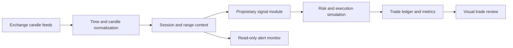

# Intraday Strategy Research

**A public, intentionally redacted portfolio case study** about designing and evaluating two rule-based Bitcoin intraday systems: a London-session range strategy and a New York-session impulse strategy.

The project demonstrates a research workflow spanning TradingView Pine Script, local backtest engines, candle-data handling, risk controls, visual trade review, and read-only alert monitoring. The executable entry/exit rules and production alert code are intentionally omitted to protect the underlying strategies.

## What the project demonstrates

- Translating discretionary session ideas into explicit, reviewable rules.
- Handling exchange candles, session timezones, and daylight-saving changes.
- Modeling next-candle execution, commissions, stops, position sizing, and drawdown.
- Comparing strategy variants and inspecting trades visually.
- Separating signal research, backtest simulation, and live read-only alerts.

## Systems at a glance

| System | Session concept | Signal concept | Exit/risk concept |
| --- | --- | --- | --- |
| London range | European morning opening range | Directional range break with volume and retest validation | Range-based invalidation, volatility distance check, structure-based exits |
| New York impulse | New York opening range | Strong directional impulse beyond the range | Signal-candle invalidation and time-based session close |

Exact times, thresholds, and executable signal logic are intentionally not published in this portfolio copy.

## Historical research snapshot

The following rounded figures summarize separate local simulations on 15-minute Binance BTCUSDC perpetual candles from early 2024 through November 2026. They are not a combined portfolio result, live results, or a forecast.

| System | Trades | Win rate | Net return | Maximum drawdown |
| --- | ---: | ---: | ---: | ---: |
| London range | 430 | 28% | +119% | 27% |
| New York impulse | 224 | 46% | +74% | 10% |

Commission was included. The local candle archives and trade-by-trade exports are not included, and the simulations do not fully model slippage, funding, order-book effects, or venue-specific fills. The systems were explored on historical data, so selection bias and overfitting are possible. These figures should be read as a case-study snapshot, not a claim of a durable edge.

## Architecture



The production implementation separates the signal logic from the data adapters and execution simulation. The public repository shows the workflow and a generic risk-sizing example; it does not contain the proprietary signal module or live watcher source.

## Generic risk-sizing example

[`src/risk_sizing.py`](src/risk_sizing.py) illustrates how a risk budget and a notional cap can constrain quantity. It is a standalone example, not either strategy's production sizing implementation.

## Project layout

```text
docs/
  architecture.md
  methodology.md
src/
  risk_sizing.py
```

Detailed strategy code remains private and can be shared with a reviewer by granting access to the separate private repository.

## Reuse

This portfolio copy is provided for review. No license is granted to reuse the strategy materials or example code without permission.
